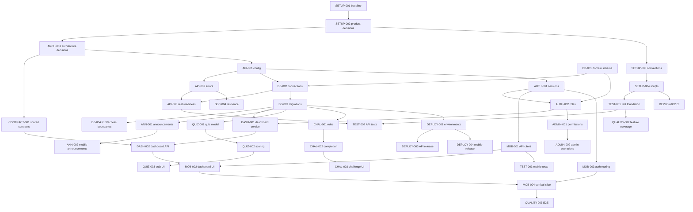

# VYRA Engineering Roadmap

Audit date: 2026-10-25  
Repository: `mr-talukdar/Vyra`  
Audited working tree: `main` at `457b412`, with a pre-existing modification in
`services/api/src/controllers/health.controller.ts`. This document is the only
file created by this audit.

## 1. Project overview and objectives

VYRA is a mobile-first employee learning, engagement, and gamification
platform. The intended product combines employee learning activities,
announcements, quizzes, daily challenges, points, streaks, leaderboards,
profiles, and administrative content management.

The repository currently contains a visual Expo prototype and a minimal
Express service. The objective of this roadmap is to move from that verified
starting point to a tested, secure, observable, deployable modular monolith
without discarding the existing mobile UI.

This is an execution plan, not a claim that the planned product requirements
have been finalized. Product and infrastructure decisions explicitly marked
below require confirmation before the dependent work is treated as committed.

## 2. Verified current repository state

### Directly verified

- The workspace is a pnpm monorepo with `apps/*`, `packages/*`, and
  `services/*` workspaces.
- The root package is named `client-platform`; the API is
  `@client-platform/api`; the mobile package is `mobile`; Expo configuration
  identifies the app as VYRA.
- The mobile app uses Expo SDK 57, React Native 0.86, TypeScript, Expo Router,
  NativeWind, and static local data.
- Mobile routes exist for Home, Learn, Leaderboard, Profile, and an
  announcement detail screen. The tab navigator is in
  `apps/mobile/src/components/app-tabs.tsx`.
- The home UI is composed from reusable components for stats, a featured
  weekly quiz, a daily challenge, and announcements.
- The API uses Express 5, JSON middleware, and two routes:
  `GET /health/live` and `GET /health/ready`.
- The readiness implementation currently simulates a database check with a
  one-second timer and returns `{ name: "VYRA", ready: true }`; it does not
  yet use the Prisma client. The controller also has a two-second timeout path
  that returns HTTP 503.
- Prisma 7 is configured with the PostgreSQL adapter and a server-only
  `SUPABASE_DIRECT_CONNECTION_STRING`; a database connection smoke test
  verifies `SELECT 1` against the configured PostgreSQL database.
- API unit/HTTP tests run without a database, while the database smoke test
  runs separately through `test:integration`.
- `packages/contracts` exists as an empty workspace directory. No shared
  schemas or types are present.
- No domain models, migrations, authentication integration, API feature
  routes, CI workflow, deployment configuration, or observability setup was
  found in tracked files. The Prisma datasource and client wiring now exist,
  but the schema still has no application models.
- `pnpm typecheck` passed for the workspaces during this audit.
- `pnpm lint` did not pass. Expo generated an untracked
  `apps/mobile/eslint.config.js` while configuring itself; that generated file
  was removed. Remaining reported issues are the unescaped apostrophe in
  `apps/mobile/src/components/NavBar.tsx`, a synchronous state update in
  `apps/mobile/src/hooks/use-color-scheme.web.ts`, and unused imports in
  `apps/mobile/src/components/ui/ReusableCard.tsx`.
- There is no verified root test, build, integration-test, or deployment
  command.

### Evidence and status summary

| Area | Status | Evidence and interpretation |
| --- | --- | --- |
| Repository/workspace | `PARTIAL` | Root `package.json`, `pnpm-workspace.yaml`, lockfile, and ignore rules exist. Package naming and documentation are inconsistent. |
| Mobile navigation and visual prototype | `PARTIAL` | Expo Router layouts and four tabs plus announcement detail exist. Screens use hard-coded content and have little interaction. |
| Mobile design primitives | `PARTIAL` | `ReusableCard`, `CircleButton`, `ReuseablePressable`, theme constants, and NativeWind setup exist; accessibility, interaction, and lint quality are incomplete. |
| Employee dashboard | `PARTIAL` | `HomeScrollView`, `StatsRow`, `FeaturedChallenge`, `DailyChallenge`, and `AnnouncementList` render demo data. No persistence or API integration exists. |
| Announcements | `PARTIAL` | List/detail presentation and route navigation exist; data, pagination, authorization, publish state, and loading/error states do not. |
| Learn/quizzes/challenges | `PARTIAL` | Learn, featured quiz, and daily challenge visuals exist; no course, quiz, attempt, completion, points, or streak behavior is implemented. |
| Leaderboard/profile | `PARTIAL` | Screens render static rankings and profile data; identity, query rules, privacy, edits, and persistence are absent. |
| Backend foundation | `PARTIAL` | Express app, server entrypoint, validated PORT configuration, request IDs, JSON error responses, health routes, and API tests exist. Security middleware, real dependency checks, and feature modules remain. |
| Health checks | `PARTIAL` | Liveness and simulated readiness are covered by HTTP tests. Readiness is still a timer simulation rather than a real dependency check, and failure/timeout cases remain. |
| Shared contracts | `NOT STARTED` | `packages/contracts` has no implementation or package manifest. |
| Database and storage | `PARTIAL` | Prisma 7 PostgreSQL client wiring, environment validation, setup documentation, and a live connection smoke test exist. Domain models, migrations, Supabase storage, and RLS remain. |
| Authentication/authorization | `NOT STARTED` | `jsonwebtoken` is listed, but no token verification, session flow, role model, or protected route exists. |
| Validation/error/security | `NOT STARTED` | No Zod, structured error format, CORS policy, security headers, rate limiting, redaction, or request validation is configured. |
| Automated testing | `PARTIAL` | Vitest/Supertest API scripts, configuration/health/error/request-ID tests, and a separate Prisma database smoke test exist. Workspace orchestration, fixtures, failure-path coverage, and database isolation remain. |
| CI/CD/deployment/operations | `NOT STARTED` | No workflow, build profile, hosting configuration, monitoring, backups, or runbook exists. |

## 3. Existing architecture and technology stack

### Current layout

```text
apps/mobile/       Expo Router mobile client and local UI components
packages/contracts Empty intended shared-contract workspace
services/api/      Express API with health routes
```

### Current responsibilities

- The mobile app owns route rendering, presentation, local assets, and
  prototype content. It currently has no API client, query cache, auth
  boundary, or persistent client state.
- The API owns only process startup and health responses. It currently has no
  domain, data-access, configuration, middleware, or feature modules.
- Supabase, Prisma, Zod, Vitest, Supertest, Zustand, TanStack Query, and React
  Hook Form are described in `readme.md` as intended technologies, but they are
  not evidence of installed or configured functionality.

### Working-tree caution

The health controller is modified relative to `HEAD` before this audit began.
Do not overwrite or discard that change while executing this roadmap. Reconcile
it deliberately in `API-002`, `API-003`, and `TEST-002`; the current
timer-backed implementation is existing work to preserve until the real
database probe is introduced.

## 4. Audit findings, assumptions, and unresolved decisions

### Findings

1. The UI is a useful prototype and should be connected incrementally rather
   than rebuilt.
2. The backend is a bootable scaffold, not an application backend.
3. The package name `client-platform`, API scope `@client-platform/api`, and
   README commands do not consistently reflect VYRA.
4. The current API `.env.example` contains only a placeholder `PORT`, and
   there is no environment validation.
5. The root `typecheck` script works, but mobile has no explicit typecheck
   script and the root recursive command relies on package discovery.
6. Lint configuration is not committed, so a clean checkout may reproduce
   Expo's auto-configuration behavior.
7. The announcement route is spelled `anouncements`; preserve compatibility
   while deciding whether to add a correctly spelled route in a controlled
   migration.

### Assumptions to validate, not silently implement

- Supabase will provide PostgreSQL, authentication, and possibly storage.
- Prisma will be used for application data access and migrations.
- A modular monolith is preferred over microservices.
- Employees and administrators are the initial roles.
- The first vertical slice will be an authenticated dashboard summary with
  persisted points/streak data and announcements.

### Decisions requiring confirmation

1. Employee identity source: Supabase Auth only, enterprise SSO, or both?
2. Required roles and scope: employee, content editor, moderator, admin,
   organization admin, and team/region managers?
3. Tenant model: one organization per deployment or multiple organizations in
   one database?
4. Database access split: Prisma through a pooled server connection for
   application data, Supabase client for Auth/Storage, or another explicit
   arrangement? Never expose a service-role secret to the mobile app.
5. Content model: courses/modules versus the currently named micro-lessons,
   and whether quizzes belong to courses, challenges, or both.
6. Points policy: idempotency, correction/reversal rules, expiration, and
   whether leaderboard totals are all-time, period-based, or both.
7. Challenge rules: one completion per day, user timezone, streak grace days,
   and reset behavior.
8. Announcement visibility: organization, team, region, audience targeting,
   scheduling, draft/publish/archive, and read tracking.
9. Media requirements: profile images, course media, certificates, and
   moderation retention.
10. Release targets: Android only initially, iOS, web, or all supported Expo
    targets; API host and deployment provider.
11. Privacy and retention requirements, including analytics, audit records, and
    account deletion/export.

### Proposed scope boundary

The following is a sequencing proposal, not a finalized product commitment.
It separates the smallest demonstrable MVP from later production hardening and
features whose behavior depends on the decisions above:

| Scope | Roadmap work | Interpretation |
| --- | --- | --- |
| MVP foundation and first slice | `M0`-`M4` and the task IDs listed in those milestones | Required to turn the existing prototype into one authenticated, persisted, tested employee workflow. |
| MVP candidate feature expansion | `ANN-001`, `ANN-002`, `QUIZ-001` through `QUIZ-003`, `CHAL-001` through `CHAL-003`, `LEAD-001`, `PROFILE-001` | Likely employee MVP capabilities, but each remains conditional on approved audience, scoring, streak, leaderboard, content, identity, and privacy decisions. |
| Later product and administration | `ANN-003`, `QUIZ-004`, `ADMIN-001` through `ADMIN-004`, `REPORT-001` | Administrative, moderation, authoring, reporting, and media features that should follow confirmed roles, tenancy, governance, and media requirements. |
| Production hardening and release | `M7`-`M8`; `QUALITY-002` through `QUALITY-005`, `SEC-001` through `SEC-004`, `DEPLOY-001` through `DEPLOY-004`, `DOC-001` | Release-readiness work. These are not substitutes for MVP functionality and should not be marked complete merely because the prototype runs locally. |

Until `SETUP-002` is approved, the candidate feature tasks remain planned
scope rather than confirmed MVP requirements. `ARCH-001`, `ADMIN-001`, and
`DEPLOY-001` remain explicitly blocked where their implementation depends on
those decisions.

## 5. Target architecture and module responsibilities

Use a modular monolith with explicit boundaries:

```text
services/api/src/
  config/          environment parsing and typed configuration
  middleware/      auth, validation, errors, request IDs, security
  modules/
    auth/
    users/
    dashboard/
    announcements/
    learning/
    quizzes/
    challenges/
    leaderboards/
    admin/
  db/              Prisma client, repositories, migrations integration
  app.ts           middleware and route composition, no listen side effects
  server.ts        configuration, startup, graceful shutdown
packages/contracts/
  src/             Zod schemas and inferred request/response types
apps/mobile/src/
  api/              typed HTTP client and auth transport
  features/         feature hooks/screens/components as integration grows
  state/            only justified client state
  app/              route and auth guards
```

- Controllers translate HTTP to application calls and return contract-shaped
  responses.
- Services enforce business rules and transaction boundaries.
- Repositories/data-access code owns Prisma queries and prevents persistence
  details leaking into controllers.
- Contracts are the shared boundary; mobile and API must consume the same
  schemas where practical.
- Supabase Auth owns identity/session primitives if confirmed. The API
  verifies access tokens and derives roles from trusted server-side data.
- Prisma owns application schema/migrations and uses the selected Supabase
  connection strategy. Supabase client usage must be limited to explicitly
  agreed Auth/Storage operations.

## 6. Milestone overview

| Milestone | Required task IDs | Exit criteria | Demonstrable outcome | Risks/blockers |
| --- | --- | --- | --- | --- |
| M0 Audit baseline | `SETUP-001`, `SETUP-002` | Current state and commands are recorded; dirty work is preserved. | Team can reproduce the baseline. | Product decisions remain open. |
| M1 Reliable local tooling | `SETUP-003`, `SETUP-004`, `QUALITY-001` | Naming, scripts, lint, and typecheck are deterministic. | Clean checkout has documented local commands. | Expo lint config behavior. |
| M2 API foundation | `API-001`, `API-002`, `API-004`, `TEST-001` | API configuration, errors, security middleware, and test infrastructure work. | The API foundation is testable without claiming database readiness. | Database choice and dependency probe remain outstanding. |
| M3 Data and identity | `ARCH-001`, `DB-001` through `DB-004`, `API-003`, `AUTH-001` through `AUTH-003`, `TEST-002` | The migrated schema, real dependency health, protected identity flow, and health/failure tests work locally. | An authenticated employee can reach a protected endpoint and readiness reflects the configured dependency. | Auth/tenant decisions. |
| M4 First vertical slice | `CONTRACT-001`, `DASH-001`, `DASH-002`, `MOB-001` through `MOB-004`, `TEST-003` | Persisted dashboard data is shown on mobile with failure states. | Employee signs in and sees real points, streak, and announcements. | Requires M3. |
| M5 Core employee features | `ANN-001` through `ANN-003`, `QUIZ-001` through `QUIZ-004`, `CHAL-001` through `CHAL-003`, `LEAD-001`, `PROFILE-001` | Core workflows and negative cases are integrated and tested. | Employee can learn, complete activities, earn points, and view rankings. | Rules need product approval. |
| M6 Administration and moderation | `ADMIN-001` through `ADMIN-004`, `REPORT-001` | Role boundaries and content lifecycle are verified. | Authorized staff can manage content and review reports. | Role/tenant model. |
| M7 Quality and operational readiness | `QUALITY-002` through `QUALITY-005`, `SEC-001` through `SEC-004` | Test, security, performance, accessibility, and observability targets pass. | Release candidate has evidence, not just code. | External services and device coverage. |
| M8 Release | `DEPLOY-001` through `DEPLOY-004`, `DOC-001` | Production deployment, mobile builds, smoke tests, rollback, and runbooks work. | A monitored release can be operated safely. | Provider credentials and approvals. |

## 7. Full phased roadmap

Each item is a checkbox so completion can be tracked. Status is evidence-based
and should change only after the acceptance criteria pass.

### Phase A - Repository conventions and requirements

#### `SETUP-001` Preserve and record the baseline

- [ ] **Status:** `PARTIAL` - audit evidence exists; this task formalizes it.
- **Objective:** Establish a reproducible baseline without losing existing work.
- **Actions:** Record the commit, package manager version, workspace packages,
  current dirty files, known routes, and baseline command output. Keep the
  health-controller change separate from roadmap work.
- **Dependencies:** None.
- **Deliverables:** Updated `ROADMAP.md`; a team-agreed baseline note in the
  normal issue/PR workflow.
- **Acceptance criteria:** A new contributor can identify what was verified,
  what failed, and which files were intentionally not changed.
- **Verification:** `git status --short`; `git log -5 --oneline`;
  `pnpm typecheck`; documented lint result.
- **Priority:** P0. **Effort:** XS.
- **Learning objective:** Learn how repository evidence differs from a
  feature claim.

#### `SETUP-002` Confirm product scope and acceptance criteria

- [ ] **Status:** `BLOCKED` - decisions in section 4 require owner input.
- **Objective:** Turn product goals into versioned, testable requirements.
- **Actions:** Confirm roles, tenancy, identity provider, learning model,
  scoring/streak rules, announcement lifecycle, privacy, supported platforms,
  and MVP exclusions. Write acceptance criteria for each MVP workflow.
- **Dependencies:** `SETUP-001`.
- **Deliverables:** Approved requirements and decision records.
- **Acceptance criteria:** Every MVP feature has an actor, success path,
  failure paths, permissions, data retention expectation, and measurable
  acceptance criteria.
- **Verification:** Product review and sign-off; unresolved items are tracked
  rather than guessed.
- **Priority:** P0. **Effort:** M.
- **Learning objective:** Practice converting UI concepts into domain rules.

#### `SETUP-003` Normalize repository conventions

- [ ] **Status:** `NOT STARTED`.
- **Objective:** Make VYRA naming and workspace usage consistent without
  breaking imports or package resolution.
- **Actions:** Decide whether to rename the root and API package identifiers,
  update scripts and documentation if approved, preserve Expo slug, and
  document the package names if renaming is deferred.
- **Dependencies:** `SETUP-002`.
- **Deliverables:** Consistent package metadata, README commands, and workspace
  documentation.
- **Acceptance criteria:** `pnpm install`, root scripts, filters, and docs
  agree on names; no unrelated rename is performed.
- **Verification:** `pnpm install --frozen-lockfile`; `pnpm typecheck`;
  inspect workspace package list.
- **Priority:** P1. **Effort:** S.
- **Learning objective:** Understand workspace package identity versus product
  branding.

#### `SETUP-004` Establish deterministic development scripts

- [x] **Status:** `DONE` - root typecheck/lint, mobile typecheck, API test/watch,
  and API development scripts exist; ESLint configuration is committed.
- **Objective:** Provide explicit, non-deceptive scripts for mobile/API
  development, type checking, linting, tests, builds, and formatting.
- **Actions:** Add only scripts backed by configured tools; add API test and
  mobile typecheck scripts; commit lint/format configuration; document
  environment setup and command scope.
- **Dependencies:** `SETUP-003`.
- **Deliverables:** Root and package scripts, committed configs, command table.
- **Acceptance criteria:** Each documented command exists or is explicitly
  labeled planned; failures return non-zero and do not auto-create config.
- **Verification:** `pnpm typecheck`; `pnpm lint`;
  `pnpm --filter @client-platform/api test`.
- **Priority:** P0. **Effort:** M.
- **Learning objective:** Learn how package scripts form a reproducible build
  interface.

### Phase B - Architecture, API foundation, and contracts

#### `ARCH-001` Record the modular-monolith and data-access decisions

- [ ] **Status:** `BLOCKED` - database and identity choices need confirmation.
- **Objective:** Finalize module boundaries, transaction ownership, and the
  Prisma/Supabase responsibility split.
- **Actions:** Decide pooled/direct database connections, migration owner,
  Auth token verification, Storage usage, tenant boundary, and error/contract
  conventions. Document decisions and rejected alternatives.
- **Dependencies:** `SETUP-002`.
- **Deliverables:** Architecture decision records and target module tree.
- **Acceptance criteria:** No feature task relies on an implicit database,
  token, or tenancy strategy.
- **Verification:** Architecture review against the target in section 5.
- **Priority:** P0. **Effort:** M.
- **Learning objective:** Understand why an ORM, Auth provider, and API need
  explicit responsibility boundaries.

#### `CONTRACT-001` Create the shared contracts package

- [ ] **Status:** `NOT STARTED`.
- **Objective:** Define stable request/response schemas for the first slice.
- **Actions:** Add package metadata and exports; use Zod schemas for health,
  auth identity, dashboard summary, and announcement list/detail; infer
  TypeScript types; define error envelopes and pagination.
- **Dependencies:** `ARCH-001`, `SETUP-004`.
- **Deliverables:** `packages/contracts` source, exports, and schema tests.
- **Acceptance criteria:** API and mobile compile against the same schemas;
  invalid payloads fail predictably; no secrets or database models are shared.
- **Verification:** Contract unit tests and workspace typecheck.
- **Priority:** P0. **Effort:** M.
- **Learning objective:** Learn schema-first API design and runtime versus
  compile-time safety.

#### `API-001` Harden application startup and configuration

- [ ] **Status:** `PARTIAL` - Zod-backed PORT parsing, range validation,
  defaults, required PostgreSQL connection-string validation, dotenv loading,
  server integration, and configuration tests are implemented. Allowed
  origins, log level, graceful shutdown, and production-specific
  configuration remain.
- **Objective:** Make startup typed, environment-aware, and safe.
- **Actions:** Add validated environment parsing, explicit port handling,
  allowed origins, log level, database URL placeholders, and graceful
  shutdown. Keep `app.ts` importable without listening.
- **Dependencies:** `ARCH-001`, `SETUP-004`.
- **Deliverables:** `config` module, complete `.env.example`, startup docs.
- **Acceptance criteria:** Missing/invalid required production variables produce
  a clear startup error; secrets are never logged; test imports do not bind a
  port.
- **Verification:** Valid/invalid environment tests; start and stop locally.
- **Priority:** P0. **Effort:** M.
- **Learning objective:** Understand twelve-factor configuration and startup
  failure modes.

#### `API-002` Define HTTP errors and request middleware

- [ ] **Status:** `PARTIAL` - request IDs, client-provided ID propagation,
  JSON 404 responses, generic 500 handling, and related HTTP tests exist.
  Stable error codes, bounded body parsing, malformed-JSON handling, and
  redacted structured logging remain.
- **Objective:** Provide consistent safe responses and request diagnostics.
- **Actions:** Add request IDs, not-found handling, typed error classes,
  final error middleware, JSON response conventions, body size limits, and
  redacted structured logging. Reconcile the pre-existing controller change
  rather than overwriting it.
- **Dependencies:** `API-001`, `CONTRACT-001`.
- **Deliverables:** Middleware modules and error contract tests.
- **Acceptance criteria:** Known validation/auth/not-found/server failures map
  to documented status codes; stack traces and secrets are absent in
  production responses/logs.
- **Verification:** Supertest-style failure cases and log redaction checks.
- **Priority:** P0. **Effort:** M.
- **Learning objective:** Learn the difference between operational and
  programmer errors at an HTTP boundary.

#### `API-003` Replace simulated readiness with dependency health

- [ ] **Status:** `PARTIAL` - route behavior and the simulated probe exist;
  replacing it with a real dependency check is not started.
- **Objective:** Make liveness and readiness meaningful.
- **Actions:** Preserve the existing liveness/ready controller behavior while
  reconciling it with the API error conventions; then inject a database health
  probe with a bounded timeout and cancellation; return a stable JSON shape
  with appropriate status codes; avoid exposing connection details.
- **Dependencies:** `API-001`, `DB-002`.
- **Deliverables:** Health service, route/controller tests, operational docs.
- **Acceptance criteria:** Liveness succeeds while the process is alive;
  readiness succeeds only when the configured database dependency is usable;
  timeout/failure returns 503.
- **Verification:** HTTP tests with healthy, failed, and timed-out probes.
- **Priority:** P0. **Effort:** S.
- **Learning objective:** Learn liveness versus readiness and bounded I/O.

#### `API-004` Add API security middleware

- [ ] **Status:** `NOT STARTED`.
- **Objective:** Establish safe defaults before protected features ship.
- **Actions:** Configure exact CORS origins, security headers, JSON/body
  limits, method handling, rate limiting where justified, and trusted proxy
  behavior. Document local versus production settings.
- **Dependencies:** `API-001`, `API-002`, `SETUP-002`.
- **Deliverables:** Security middleware and configuration tests.
- **Acceptance criteria:** Unauthorized origins are rejected; headers and
  limits are verified; health routes remain usable by monitoring.
- **Verification:** Integration tests for origins, headers, oversized bodies,
  and rate-limit behavior.
- **Priority:** P0. **Effort:** M.
- **Learning objective:** Understand defense-in-depth at an API edge.

### Phase C - Database and authentication

#### `DB-001` Model the initial domain and constraints

- [ ] **Status:** `NOT STARTED`.
- **Objective:** Define a normalized, auditable MVP schema.
- **Actions:** Model users/profiles, organizations if required, roles,
  announcements, courses/modules, quizzes/questions, attempts, challenges,
  completions, points ledger, streak snapshots, and audit records. Define
  unique keys, foreign keys, indexes, timestamps, soft-delete/archive rules,
  and idempotency keys.
- **Dependencies:** `SETUP-002`, `ARCH-001`.
- **Deliverables:** Reviewed Prisma schema design and ERD/decision record.
- **Acceptance criteria:** Rules prevent duplicate completions and invalid
  scores; tenant and role scope are explicit; unbounded arrays are avoided.
- **Verification:** Schema review and constraint-focused model tests.
- **Priority:** P0. **Effort:** L.
- **Learning objective:** Learn to encode business invariants in a database.

#### `DB-002` Configure Prisma and Supabase connections

- [ ] **Status:** `PARTIAL` - Prisma 7, the PostgreSQL adapter, a generated
  client, server-side client wiring, direct Supabase connection-string
  validation, setup documentation, and a live `SELECT 1` smoke test exist.
  Domain models, migrations, pooling/direct URL strategy, connection limits,
  and production lifecycle handling remain.
- **Objective:** Establish safe local and production database connectivity.
- **Actions:** Add Prisma schema/client lifecycle, migration commands,
  pooled/direct URL strategy, SSL requirements, connection limits, and a
  server-only Supabase client only where approved.
- **Dependencies:** `ARCH-001`, `DB-001`, `API-001`.
- **Deliverables:** Prisma config, client module, environment keys, local
  setup documentation.
- **Acceptance criteria:** API uses one managed client lifecycle; mobile has
  no database or service-role credentials; connection strategy works against
  the selected Supabase setup.
- **Verification:** Connection smoke test and clean process shutdown.
- **Priority:** P0. **Effort:** M.
- **Learning objective:** Understand pooling, migrations, and secret
  boundaries.

#### `DB-003` Create and verify migrations and seed data

- [ ] **Status:** `NOT STARTED`.
- **Objective:** Make schema changes repeatable and testable.
- **Actions:** Create initial migration, safe development seed fixtures,
  migration reset strategy for disposable environments, and production
  migration procedure. Never use seed data as proof of product behavior.
- **Dependencies:** `DB-002`.
- **Deliverables:** Tracked migrations, seed command, migration runbook.
- **Acceptance criteria:** A blank database migrates deterministically; seed
  data satisfies constraints; production procedure is non-destructive.
- **Verification:** Apply migrations to a disposable database and query key
  records.
- **Priority:** P0. **Effort:** M.
- **Learning objective:** Learn migration discipline and fixture design.

#### `DB-004` Configure Supabase RLS and data-access boundaries

- [ ] **Status:** `NOT STARTED`.
- **Objective:** Prevent cross-user and cross-tenant data access.
- **Actions:** Decide whether API-only Prisma access or direct client access is
  used per table; add RLS policies if Supabase client access is allowed;
  verify service-role isolation; add repository filters and authorization
  tests.
- **Dependencies:** `DB-003`, `AUTH-002`, `SETUP-002`.
- **Deliverables:** RLS policies or documented API-only decision, repository
  tests, access-control runbook.
- **Acceptance criteria:** A user cannot read or mutate another user's
  protected data; administrative scope is tested; service-role secrets never
  reach the mobile bundle.
- **Verification:** Positive and negative database/API access tests.
- **Priority:** P0. **Effort:** L.
- **Learning objective:** Understand defense in depth between API authorization
  and database policy enforcement.

#### `AUTH-001` Implement authentication bootstrap

- [ ] **Status:** `NOT STARTED`.
- **Objective:** Provide the selected sign-in, sign-out, refresh, and
  bootstrap behavior.
- **Actions:** Configure Supabase Auth or approved identity provider; define
  mobile secure token storage and renewal; add API token extraction and
  verification; define invalid/expired token responses.
- **Dependencies:** `SETUP-002`, `API-001`, `ARCH-001`.
- **Deliverables:** Auth configuration, mobile auth transport, API verifier.
- **Acceptance criteria:** A real test user can sign in, restart the app,
  refresh a session, sign out, and receive 401 after expiry.
- **Verification:** Auth integration tests and device/manual session checks.
- **Priority:** P0. **Effort:** L.
- **Learning objective:** Learn session lifecycle and why tokens must be
  handled differently on client and server.

#### `AUTH-002` Add users, roles, and authorization middleware

- [ ] **Status:** `NOT STARTED`.
- **Objective:** Make identity and permissions available to modules.
- **Actions:** Sync/authenticate profile records, define role claims or
  server-side role lookup, add `requireUser` and `requireRole` middleware,
  and implement deny-by-default policy helpers.
- **Dependencies:** `DB-001`, `AUTH-001`.
- **Deliverables:** User/profile module, authorization middleware, policy tests.
- **Acceptance criteria:** Missing, invalid, insufficient, and revoked access
  cases return safe responses; role checks cannot be bypassed by client input.
- **Verification:** Matrix tests for each role and protected route.
- **Priority:** P0. **Effort:** M.
- **Learning objective:** Understand authentication versus authorization.

#### `AUTH-003` Build account management and privacy controls

- [ ] **Status:** `NOT STARTED`.
- **Objective:** Support profile viewing/editing and account lifecycle safely.
- **Actions:** Add validated profile updates, avatar policy, password/provider
  boundaries, account deletion/export decisions, and audit events.
- **Dependencies:** `AUTH-002`, `DB-004`, `SETUP-002`.
- **Deliverables:** Profile API/mobile screens, privacy documentation, tests.
- **Acceptance criteria:** Users can update only allowed fields; sensitive
  fields are excluded from responses; deletion/export behavior is explicit.
- **Verification:** Authorization, validation, and redaction tests.
- **Priority:** P1. **Effort:** M.
- **Learning objective:** Learn data minimization and privacy-aware APIs.

### Phase D - First end-to-end vertical slice

#### `DASH-001` Implement dashboard read model and service

- [ ] **Status:** `NOT STARTED`.
- **Objective:** Replace hard-coded points/streak values with persisted,
  authenticated data.
- **Actions:** Define summary query and DTO; calculate points/streak from
  authoritative records; include current challenge and a bounded announcement
  preview; handle missing profile and empty data.
- **Dependencies:** `DB-003`, `AUTH-002`, `CONTRACT-001`.
- **Deliverables:** Dashboard service/repository and response contract.
- **Acceptance criteria:** Response is scoped to the authenticated employee,
  has stable fields, and does not expose internal database columns.
- **Verification:** Unit tests for totals, empty state, and cross-user denial.
- **Priority:** P0. **Effort:** M.
- **Learning objective:** Learn read models and server-owned derived values.

#### `DASH-002` Expose the dashboard endpoint

- [ ] **Status:** `NOT STARTED`.
- **Objective:** Provide a protected, documented dashboard API.
- **Actions:** Add route/controller, auth middleware, validation for any
  filters, pagination for announcements, error mapping, and request logs
  without sensitive values.
- **Dependencies:** `DASH-001`, `API-002`, `AUTH-002`.
- **Deliverables:** `GET /v1/dashboard` (or approved equivalent), OpenAPI-like
  contract documentation, integration tests.
- **Acceptance criteria:** Valid user gets the contract; anonymous users get
  401; malformed parameters get 400; dependency failure gets safe 5xx.
- **Verification:** HTTP integration tests for success and all listed failures.
- **Priority:** P0. **Effort:** M.
- **Learning objective:** Learn controller/service separation and contract
  testing.

#### `MOB-001` Add the mobile API and session foundation

- [ ] **Status:** `NOT STARTED`.
- **Objective:** Connect the Expo app to a configurable API safely.
- **Actions:** Add base URL configuration, typed request client, timeout and
  cancellation behavior, auth header injection, response validation, and
  normalized error handling. Keep secrets out of the bundle.
- **Dependencies:** `AUTH-001`, `CONTRACT-001`, `API-002`.
- **Deliverables:** Mobile API client and environment documentation.
- **Acceptance criteria:** Local/preview/prod base URLs are selectable;
  non-2xx and invalid response shapes are visible to the UI.
- **Verification:** Mocked client tests and a local API request.
- **Priority:** P0. **Effort:** M.
- **Learning objective:** Learn client/server configuration and runtime
  response validation.

#### `MOB-002` Add dashboard query, cache, and UI states

- [ ] **Status:** `NOT STARTED`.
- **Objective:** Reuse the existing home UI with real server state.
- **Actions:** Add TanStack Query only after confirming it is the chosen
  dependency; map dashboard fields into existing components; implement
  loading skeletons, empty states, retry, offline/stale behavior, and
  pull-to-refresh.
- **Dependencies:** `DASH-002`, `MOB-001`.
- **Deliverables:** Query provider, dashboard hook, updated home components.
- **Acceptance criteria:** No demo values are shown as successful server data;
  loading, empty, error, and refresh states are distinguishable.
- **Verification:** Component/query tests and device check against local API.
- **Priority:** P0. **Effort:** M.
- **Learning objective:** Learn server state versus UI/client state.

#### `MOB-003` Add auth-aware routing and profile bootstrap

- [ ] **Status:** `NOT STARTED`.
- **Objective:** Prevent protected screens from rendering as authenticated
  before session restoration completes.
- **Actions:** Add root auth state, loading gate, sign-in route, protected
  tab guard, sign-out, and expired-session recovery.
- **Dependencies:** `AUTH-001`, `MOB-001`.
- **Deliverables:** Auth routes/guard and session UI states.
- **Acceptance criteria:** Signed-out users cannot access protected data;
  session restoration is flicker-free enough for the target platform; sign-out
  clears cached private data.
- **Verification:** Navigation tests and manual cold-start/session-expiry checks.
- **Priority:** P0. **Effort:** M.
- **Learning objective:** Understand navigation as an authorization surface.

#### `MOB-004` Complete the first slice acceptance check

- [ ] **Status:** `NOT STARTED`.
- **Objective:** Demonstrate the smallest meaningful product path end to end.
- **Actions:** Create a test employee, seed persisted summary data, sign in,
  load dashboard, open one announcement, exercise API failure/retry, and
  record evidence.
- **Dependencies:** `DASH-002`, `MOB-002`, `MOB-003`, `TEST-003`.
- **Deliverables:** Acceptance checklist and reproducible local scenario.
- **Acceptance criteria:** The mobile UI displays the authenticated user's
  persisted points/streak and announcement data; no screen silently falls
  back to demo content.
- **Verification:** API integration tests plus Android/device manual check.
- **Priority:** P0. **Effort:** S.
- **Learning objective:** Learn vertical-slice validation across boundaries.

### Phase E - Core employee features

#### `ANN-001` Build announcement domain and read APIs

- [ ] **Status:** `PARTIAL` - static list/detail UI exists.
- **Objective:** Persist and serve announcements with lifecycle and audience
  rules.
- **Actions:** Add model constraints, list/detail contracts, pagination,
  audience filtering, draft/published/archived states, read tracking decision,
  and not-found behavior.
- **Dependencies:** `DB-001`, `DB-003`, `AUTH-002`, `CONTRACT-001`.
- **Deliverables:** Announcement service/routes/repository and tests.
- **Acceptance criteria:** Employees see only published authorized items;
  archived/unpublished items are excluded; detail and list agree.
- **Verification:** Permission, pagination, empty, and not-found tests.
- **Priority:** P0. **Effort:** L.
- **Learning objective:** Learn content lifecycle and audience scoping.

#### `ANN-002` Integrate announcement list/detail UI

- [ ] **Status:** `PARTIAL` - navigation exists but uses local arrays.
- **Objective:** Replace local announcements while preserving the current UX.
- **Actions:** Correct or alias the `anouncements` route after a compatibility
  decision; add query states, refresh, deep-link handling, accessibility
  labels, and safe rendering of server content.
- **Dependencies:** `ANN-001`, `MOB-002`.
- **Deliverables:** Connected list/detail screens and mobile tests.
- **Acceptance criteria:** List/detail work for loading, empty, error, missing,
  and successful data; no stale local fixture is presented as authoritative.
- **Verification:** Component/navigation tests and device deep-link check.
- **Priority:** P0. **Effort:** M.
- **Learning objective:** Learn incremental integration without rebuilding UI.

#### `ANN-003` Add administrative announcement lifecycle

- [ ] **Status:** `NOT STARTED`.
- **Objective:** Allow approved roles to create, edit, publish, archive, and
  preview announcements.
- **Actions:** Add validated mutations, role/tenant policy, optimistic-lock
  or version checks, audit events, and moderation/rollback behavior.
- **Dependencies:** `ANN-001`, `AUTH-002`, `ADMIN-001`.
- **Deliverables:** Admin API/UI or documented admin surface, tests, runbook.
- **Acceptance criteria:** Employees cannot mutate content; authorized staff
  can perform only approved transitions; every transition is auditable.
- **Verification:** Role matrix, conflict, validation, and audit tests.
- **Priority:** P1. **Effort:** L.
- **Learning objective:** Learn workflow state machines and least privilege.

#### `QUIZ-001` Model quiz content and publishing rules

- [ ] **Status:** `NOT STARTED`.
- **Objective:** Define weekly quiz content, questions, answers, scoring, and
  publication constraints.
- **Actions:** Model question types and answer storage, prevent answer leakage
  in employee responses, version published quizzes, and define timing/attempt
  policy.
- **Dependencies:** `DB-001`, `SETUP-002`.
- **Deliverables:** Schema, contracts, content rules, fixtures.
- **Acceptance criteria:** Published quiz versions are immutable; employee
  payloads cannot reveal correct answers before submission.
- **Verification:** Schema and response-shaping tests.
- **Priority:** P1. **Effort:** L.
- **Learning objective:** Learn secure assessment modeling.

#### `QUIZ-002` Implement attempts, scoring, and rewards

- [ ] **Status:** `NOT STARTED`.
- **Objective:** Make quiz completion correct and idempotent.
- **Actions:** Add attempt lifecycle, server-side scoring, one-time reward
  ledger entries, retries/idempotency keys, validation, and transaction
  boundaries.
- **Dependencies:** `QUIZ-001`, `DB-003`, `AUTH-002`.
- **Deliverables:** Quiz service/routes and unit/integration tests.
- **Acceptance criteria:** Scores cannot be client-forged; duplicate
  submission cannot award points twice; invalid answers are rejected safely.
- **Verification:** Scoring, duplicate, timeout, and authorization tests.
- **Priority:** P1. **Effort:** L.
- **Learning objective:** Learn transactional business logic and idempotency.

#### `QUIZ-003` Integrate weekly quiz mobile flow

- [ ] **Status:** `PARTIAL` - featured card is visual only.
- **Objective:** Turn the existing featured challenge into a usable quiz path.
- **Actions:** Add query/mutation hooks, question rendering, answer state,
  submit confirmation, progress, result, retry, and offline/error behavior.
- **Dependencies:** `QUIZ-002`, `MOB-001`, `MOB-002`.
- **Deliverables:** Quiz routes/components and mobile tests.
- **Acceptance criteria:** Users can start, answer, submit once, see server
  result, and see updated points after cache invalidation.
- **Verification:** Navigation/component tests and device workflow.
- **Priority:** P1. **Effort:** L.
- **Learning objective:** Learn mutation state and server-authoritative UI.

#### `QUIZ-004` Add quiz administration and moderation

- [ ] **Status:** `NOT STARTED`.
- **Objective:** Provide safe content authoring and publication.
- **Actions:** Add draft editing, validation preview, publish/version/archive,
  role checks, audit events, and correction policy.
- **Dependencies:** `QUIZ-001`, `ANN-003`, `ADMIN-001`.
- **Deliverables:** Admin workflows and tests.
- **Acceptance criteria:** Incomplete or invalid quizzes cannot publish;
  published attempts retain their version semantics.
- **Verification:** Negative publication and version compatibility tests.
- **Priority:** P1. **Effort:** L.
- **Learning objective:** Learn content governance.

#### `CHAL-001` Define daily challenge, points, and streak rules

- [ ] **Status:** `PARTIAL` - daily challenge card is static.
- **Objective:** Make completion and streak calculations explicit and fair.
- **Actions:** Confirm timezone, daily boundary, repeat behavior, grace days,
  points ledger, reversals, and concurrency/idempotency rules.
- **Dependencies:** `SETUP-002`, `DB-001`.
- **Deliverables:** Decision record, schema constraints, rule examples.
- **Acceptance criteria:** Rules cover timezone changes, duplicate requests,
  missed days, concurrent completion, and correction.
- **Verification:** Property/unit tests for boundary dates and duplicates.
- **Priority:** P1. **Effort:** M.
- **Learning objective:** Learn time-dependent domain logic.

#### `CHAL-002` Implement challenge completion and streak service

- [ ] **Status:** `NOT STARTED`.
- **Objective:** Persist completion and calculate rewards server-side.
- **Actions:** Add challenge query, completion mutation, transaction/ledger,
  streak update, authorization, and failure recovery.
- **Dependencies:** `CHAL-001`, `AUTH-002`, `DB-003`.
- **Deliverables:** Challenge module and integration tests.
- **Acceptance criteria:** One valid completion awards exactly one reward;
  unauthorized, expired, duplicate, and malformed requests fail safely.
- **Verification:** Concurrent and idempotency tests plus database checks.
- **Priority:** P1. **Effort:** L.
- **Learning objective:** Learn atomic writes and derived state.

#### `CHAL-003` Integrate daily challenge UI

- [ ] **Status:** `PARTIAL` - Begin control has no action.
- **Objective:** Connect the existing card to challenge state and mutation.
- **Actions:** Add loading/disabled/submitted/error states, accessible action
  labels, completion refresh, and optimistic behavior only if safe.
- **Dependencies:** `CHAL-002`, `MOB-002`.
- **Deliverables:** Updated `DailyChallenge` and tests.
- **Acceptance criteria:** UI reflects server completion and cannot double-submit.
- **Verification:** Mutation tests and device interaction check.
- **Priority:** P1. **Effort:** M.
- **Learning objective:** Learn safe mutation UX.

#### `LEAD-001` Implement scoped leaderboards

- [ ] **Status:** `PARTIAL` - rankings are static.
- **Objective:** Define and serve fair, privacy-aware rankings.
- **Actions:** Confirm period/timezone/tie rules and visibility; add indexed
  aggregate query or read model, pagination, cache policy, and current-user
  rank response.
- **Dependencies:** `DB-001`, `CHAL-002`, `QUIZ-002`, `AUTH-002`, `SETUP-002`.
- **Deliverables:** Leaderboard API, mobile query, updated screen, tests.
- **Acceptance criteria:** Ranking order and ties are deterministic; scope and
  privacy rules are enforced; current user can be located without exposing
  prohibited data.
- **Verification:** Aggregate, permission, tie, empty, and pagination tests.
- **Priority:** P1. **Effort:** L.
- **Learning objective:** Learn aggregate queries and privacy-aware ranking.

#### `PROFILE-001` Connect the profile screen

- [ ] **Status:** `PARTIAL` - static profile, badges, and credentials exist.
- **Objective:** Display authenticated profile and progress from the API.
- **Actions:** Map profile/stats/badges, add edit settings where approved,
  implement loading/empty/error states, remove fake credential claims, and
  define certificate verification.
- **Dependencies:** `AUTH-003`, `DASH-001`, `MOB-002`, `SETUP-002`.
- **Deliverables:** Profile API/client integration and tests.
- **Acceptance criteria:** Screen reflects the signed-in user; unavailable
  credentials are not represented as verified facts; edits obey policy.
- **Verification:** API authorization and mobile state tests.
- **Priority:** P1. **Effort:** M.
- **Learning objective:** Learn safe migration from design fixture to account data.

### Phase F - Administration, reporting, and media

#### `ADMIN-001` Define the role and permission matrix

- [ ] **Status:** `BLOCKED` - roles and tenant scope are unresolved.
- **Objective:** Make every administrative operation explicitly authorized.
- **Actions:** Build an operation-by-role matrix for users, content,
  moderation, reports, and audit data; define tenant boundaries and emergency
  access.
- **Dependencies:** `SETUP-002`, `AUTH-002`.
- **Deliverables:** Permission matrix and policy tests.
- **Acceptance criteria:** Every admin route references a named permission;
  default behavior is deny; employee access is separately tested.
- **Verification:** Matrix review and automated policy tests.
- **Priority:** P0. **Effort:** M.
- **Learning objective:** Learn permission design before route implementation.

#### `ADMIN-002` Implement user/content management operations

- [ ] **Status:** `NOT STARTED`.
- **Objective:** Provide controlled administrative management.
- **Actions:** Add paginated user search, role changes with safeguards,
  content assignment, deactivate/reactivate rules, validation, audit events,
  and optimistic conflict handling.
- **Dependencies:** `ADMIN-001`, `DB-004`, `API-002`.
- **Deliverables:** Admin service/routes and tests.
- **Acceptance criteria:** Scope, pagination, and mutation permissions are
  enforced; sensitive fields are never searchable or returned accidentally.
- **Verification:** Role/tenant/validation/concurrency tests.
- **Priority:** P1. **Effort:** L.
- **Learning objective:** Learn safe administrative mutation design.

#### `ADMIN-003` Add reporting and moderation workflows

- [ ] **Status:** `NOT STARTED`.
- **Objective:** Support abuse/content reports and accountable resolution.
- **Actions:** Confirm reportable entities and retention; model report states,
  reviewer actions, evidence access, notifications, and audit trail.
- **Dependencies:** `ADMIN-001`, `SETUP-002`.
- **Deliverables:** Report/moderation module and tests.
- **Acceptance criteria:** Reporter privacy and reviewer permissions are
  enforced; state transitions and decisions are auditable.
- **Verification:** Workflow and unauthorized-access tests.
- **Priority:** P2. **Effort:** L.
- **Learning objective:** Learn moderation as a controlled workflow.

#### `ADMIN-004` Add approved media/storage support

- [ ] **Status:** `NOT STARTED`.
- **Objective:** Store only confirmed media with safe access and lifecycle.
- **Actions:** Decide media types/limits; configure private buckets and signed
  URLs if Supabase Storage is approved; validate MIME/size; scan or moderate;
  add deletion/retention rules.
- **Dependencies:** `SETUP-002`, `ARCH-001`, `AUTH-002`.
- **Deliverables:** Storage policy, server endpoints, mobile upload/display
  states, and tests.
- **Acceptance criteria:** Mobile never receives privileged storage credentials;
  unauthorized objects cannot be fetched; rejected files are handled clearly.
- **Verification:** Upload, expiry, authorization, and size/type tests.
- **Priority:** P2. **Effort:** L.
- **Learning objective:** Learn signed access and untrusted file handling.

#### `REPORT-001` Define engagement analytics and privacy

- [ ] **Status:** `NOT STARTED`.
- **Objective:** Measure product health without collecting unjustified data.
- **Actions:** Define events, aggregation, retention, consent, access, export,
  and deletion; prefer server-side aggregates for reports.
- **Dependencies:** `SETUP-002`, `AUTH-003`, `ADMIN-001`.
- **Deliverables:** Event taxonomy, reporting queries, privacy documentation.
- **Acceptance criteria:** Every collected event has a purpose, owner,
  retention, and access policy; personal data is minimized.
- **Verification:** Data review and report authorization tests.
- **Priority:** P2. **Effort:** M.
- **Learning objective:** Learn useful analytics without surveillance by default.

### Phase G - Quality, security, and operations

#### `TEST-001` Establish backend test infrastructure

- [ ] **Status:** `PARTIAL` - Vitest/Supertest scripts, configuration tests,
  health tests, error tests, request-ID tests, and a separately run Prisma
  database connection smoke test exist. Shared test configuration, workspace
  orchestration, fixtures, failure-path coverage, and database isolation
  remain.
- **Objective:** Add the intended Vitest/Supertest foundation without claiming
  coverage prematurely.
- **Actions:** Configure unit and HTTP integration projects, test app imports,
  fixtures, disposable database strategy, and CI-friendly commands.
- **Dependencies:** `SETUP-004`, `API-001`, `API-002`.
- **Deliverables:** Test config, scripts, health/error tests.
- **Acceptance criteria:** Tests run in a clean environment, isolate state,
  and fail on regressions.
- **Verification:** `pnpm --filter @client-platform/api test` and
  `pnpm --filter @client-platform/api test:integration`.
- **Priority:** P0. **Effort:** M.
- **Learning objective:** Learn test boundaries and dependency isolation.

#### `TEST-002` Cover health and API failure behavior

- [ ] **Status:** `PARTIAL` - liveness, readiness success, 404, generic 500,
  generated request IDs, and client-provided request IDs are covered.
  Readiness failure/timeout, malformed JSON, body limits, and redaction
  assertions remain.
- **Objective:** Prove baseline routes and middleware behavior.
- **Actions:** Test liveness, readiness success/timeout/failure, malformed
  JSON, 404, error envelope, request IDs, and redaction.
- **Dependencies:** `API-002`, `API-003`, `TEST-001`.
- **Deliverables:** Integration tests and recorded baseline.
- **Acceptance criteria:** Both success and negative cases are deterministic.
- **Verification:** `pnpm --filter @client-platform/api test` (after created).
- **Priority:** P0. **Effort:** S.
- **Learning objective:** Learn black-box HTTP verification.

#### `TEST-003` Add mobile component and integration tests

- [ ] **Status:** `NOT STARTED`.
- **Objective:** Protect existing UI while replacing fixtures with data.
- **Actions:** Configure the chosen React Native test runner; test route
  rendering, accessibility labels, query states, retry, auth guard, and
  announcement deep links with mocked contracts.
- **Dependencies:** `CONTRACT-001`, `MOB-001`.
- **Deliverables:** Mobile test config, fixtures, and critical-path tests.
- **Acceptance criteria:** Tests cover success, loading, empty, error, and
  unauthorized behavior for the first slice.
- **Verification:** Package test command and device smoke check.
- **Priority:** P0. **Effort:** M.
- **Learning objective:** Learn deterministic UI tests around server state.

#### `QUALITY-001` Fix and lock baseline quality gates

- [ ] **Status:** `PARTIAL` - typecheck passes; lint fails.
- **Objective:** Make lint/typecheck output reliable and clean.
- **Actions:** Commit appropriate ESLint config, fix the apostrophe and web
  hydration lint issue, remove unused imports, add formatting policy, and
  ensure the root command does not mutate files.
- **Dependencies:** `SETUP-004`.
- **Deliverables:** Config, fixes, and clean quality scripts.
- **Acceptance criteria:** `pnpm typecheck` and `pnpm lint` pass from a clean
  checkout without generated untracked configuration.
- **Verification:** Run both commands twice from a clean working tree.
- **Priority:** P0. **Effort:** S.
- **Learning objective:** Learn how quality tooling is part of the product
  contract.

#### `QUALITY-002` Expand feature test coverage

- [ ] **Status:** `NOT STARTED`.
- **Objective:** Test business rules, contracts, permissions, migrations,
  mobile states, and critical workflows as features are added.
- **Actions:** Maintain a test matrix for each module; require success and
  negative cases; add migration smoke tests and contract compatibility checks.
- **Dependencies:** `TEST-001`, `TEST-003`, feature tasks.
- **Deliverables:** Coverage thresholds chosen from risk, not vanity, and CI
  reports.
- **Acceptance criteria:** No important feature is marked complete without
  relevant failure and authorization tests.
- **Verification:** Unit, integration, mobile, and end-to-end commands.
- **Priority:** P0. **Effort:** L.
- **Learning objective:** Learn risk-based test planning.

#### `QUALITY-003` Add end-to-end and production smoke testing

- [ ] **Status:** `NOT STARTED`.
- **Objective:** Verify sign-in and employee workflows on a real build/API.
- **Actions:** Choose device/browser coverage, seed isolated accounts, test
  sign-in, dashboard, announcement, quiz/challenge completion, sign-out,
  network failure, and upgrade/migration behavior.
- **Dependencies:** `MOB-004`, `QUALITY-002`, `DEPLOY-001`.
- **Deliverables:** E2E suite and release smoke checklist.
- **Acceptance criteria:** Critical path passes on supported release targets;
  test data is isolated and credentials are not committed.
- **Verification:** E2E runner and deployed-environment smoke test.
- **Priority:** P1. **Effort:** L.
- **Learning objective:** Learn why unit tests cannot prove release readiness.

#### `SEC-001` Perform threat modeling and privacy review

- [ ] **Status:** `NOT STARTED`.
- **Objective:** Identify abuse cases before production.
- **Actions:** Review token theft, IDOR, privilege escalation, answer leakage,
  points forgery, replay/double submit, injection, file abuse, log leakage,
  denial of service, and privacy/retention risks.
- **Dependencies:** `SETUP-002`, `AUTH-002`, `DB-004`, feature modules.
- **Deliverables:** Threat model, mitigations, and residual-risk register.
- **Acceptance criteria:** High-risk threats have tested mitigations or an
  explicit accepted risk owner.
- **Verification:** Security review and adversarial test cases.
- **Priority:** P0. **Effort:** M.
- **Learning objective:** Learn threat modeling from actual data flows.

#### `SEC-002` Harden dependencies and secrets

- [ ] **Status:** `NOT STARTED`.
- **Objective:** Keep credentials and dependencies maintainable.
- **Actions:** Add secret scanning, lockfile review, dependency update policy,
  least-privilege environment variables, rotation procedure, and CI secret
  handling.
- **Dependencies:** `API-001`, `SEC-001`, `DEPLOY-001`.
- **Deliverables:** CI checks, secret runbook, dependency policy.
- **Acceptance criteria:** No secret is in source/bundle/logs; vulnerable
  dependency response and rotation steps are documented.
- **Verification:** Secret scanner and clean build inspection.
- **Priority:** P0. **Effort:** M.
- **Learning objective:** Learn operational secret management.

#### `SEC-003` Verify privacy, accessibility, and secure UX

- [ ] **Status:** `NOT STARTED`.
- **Objective:** Make the mobile experience safe and usable.
- **Actions:** Add labels/roles, contrast and text scaling checks, keyboard and
  screen-reader paths, secure token storage review, privacy-safe errors, and
  account deletion/export UX.
- **Dependencies:** `AUTH-003`, `MOB-002`, `SETUP-002`.
- **Deliverables:** Accessibility checklist and fixes.
- **Acceptance criteria:** Critical workflows are usable with target assistive
  technologies and do not expose sensitive data in UI errors.
- **Verification:** Accessibility audit on supported devices.
- **Priority:** P1. **Effort:** M.
- **Learning objective:** Learn accessibility and privacy as acceptance criteria.

#### `SEC-004` Add resilience, timeout, and performance controls

- [ ] **Status:** `NOT STARTED`.
- **Objective:** Keep the system predictable under slow or failing dependencies.
- **Actions:** Set DB/HTTP timeouts, retries only for idempotent operations,
  pagination limits, indexes, cache policy, request cancellation, graceful
  shutdown, and load targets.
- **Dependencies:** `API-002`, `DB-004`, `QUALITY-002`.
- **Deliverables:** Resilience configuration, performance measurements, and
  runbook.
- **Acceptance criteria:** Slow dependencies fail boundedly; mutations are not
  duplicated by automatic retries; target latency/throughput is recorded.
- **Verification:** Timeout, load, and failure-injection tests.
- **Priority:** P1. **Effort:** M.
- **Learning objective:** Learn reliability as controlled failure behavior.

#### `QUALITY-004` Add observability and operational alerts

- [ ] **Status:** `NOT STARTED`.
- **Objective:** Make production failures diagnosable without leaking data.
- **Actions:** Add structured logs, request IDs, error reporting, health
  dashboards, latency/error metrics, alert thresholds, and redaction.
- **Dependencies:** `API-002`, `API-003`, `SEC-001`.
- **Deliverables:** Monitoring configuration, dashboards, alerts, and runbook.
- **Acceptance criteria:** Operators can trace a failed request by ID without
  reading secrets or raw personal data.
- **Verification:** Inject a controlled error and verify alert/trace.
- **Priority:** P1. **Effort:** M.
- **Learning objective:** Learn observability signals and incident diagnosis.

#### `QUALITY-005` Define backup, restore, and incident response

- [ ] **Status:** `NOT STARTED`.
- **Objective:** Prove recovery is possible for the selected database/service.
- **Actions:** Confirm Supabase backup tier, retention, point-in-time options,
  restore test cadence, migration rollback limits, incident roles, and
  communication templates.
- **Dependencies:** `DB-003`, `SEC-001`, `DEPLOY-001`.
- **Deliverables:** Restore evidence and incident runbook.
- **Acceptance criteria:** A disposable restore is completed and measured;
  recovery objectives and owners are documented.
- **Verification:** Scheduled restore drill.
- **Priority:** P1. **Effort:** M.
- **Learning objective:** Learn recovery objectives beyond backups existing.

### Phase H - CI/CD, deployment, and documentation

#### `DEPLOY-001` Choose environments and API hosting

- [ ] **Status:** `BLOCKED` - provider, domain, and credentials are unknown.
- **Objective:** Define reproducible local, preview, staging, and production
  environments.
- **Actions:** Choose API host, database projects, domains, deployment method,
  environment variable ownership, migration execution, and rollback strategy.
- **Dependencies:** `SETUP-002`, `ARCH-001`, `API-001`.
- **Deliverables:** Environment matrix and deployment decision record.
- **Acceptance criteria:** Every environment has an owner, URL, secrets source,
  data policy, and promotion path.
- **Verification:** Review and disposable deployment.
- **Priority:** P0. **Effort:** M.
- **Learning objective:** Learn environment parity and promotion safety.

#### `DEPLOY-002` Add CI checks

- [ ] **Status:** `NOT STARTED`.
- **Objective:** Reject regressions before merge.
- **Actions:** Run install with frozen lockfile, typecheck, lint, unit tests,
  integration tests with services, migration checks, and secret scanning.
  Cache safely and publish actionable failures.
- **Dependencies:** `SETUP-004`, `TEST-001`, `SEC-002`.
- **Deliverables:** CI workflow(s) and branch protection recommendations.
- **Acceptance criteria:** A failing quality/security check blocks the intended
  merge path; CI does not require developer secrets.
- **Verification:** Run workflow on a test branch and inspect artifacts.
- **Priority:** P0. **Effort:** M.
- **Learning objective:** Learn CI as a reproducible environment, not a badge.

#### `DEPLOY-003` Configure API deployment and migrations

- [ ] **Status:** `NOT STARTED`.
- **Objective:** Deploy the API safely with health checks and migration
  discipline.
- **Actions:** Build artifact, inject secrets, run pre-deploy migrations,
  configure startup/shutdown, health probes, logs, autoscaling/limits, and
  rollback.
- **Dependencies:** `DEPLOY-001`, `DEPLOY-002`, `API-003`, `DB-003`.
- **Deliverables:** Deployment configuration and runbook.
- **Acceptance criteria:** Staging deployment is repeatable; unhealthy
  instances are removed; migration failure stops promotion safely.
- **Verification:** Staging deploy, smoke test, rollback drill.
- **Priority:** P1. **Effort:** L.
- **Learning objective:** Learn deployment ordering and health-driven rollout.

#### `DEPLOY-004` Configure Expo preview and production releases

- [ ] **Status:** `NOT STARTED`.
- **Objective:** Produce signed, environment-correct mobile builds.
- **Actions:** Choose EAS profiles, app identifiers, signing ownership,
  runtime API configuration, update policy, privacy metadata, store
  submission, and rollback/OTA policy.
- **Dependencies:** `DEPLOY-001`, `MOB-004`, `SEC-002`.
- **Deliverables:** EAS/build configuration, release checklist, signed preview.
- **Acceptance criteria:** Preview points only to non-production data; a
  production build points to production API without embedded secrets; release
  can be rolled back.
- **Verification:** Android and approved iOS/device build smoke tests.
- **Priority:** P1. **Effort:** L.
- **Learning objective:** Learn mobile release channels and configuration.

#### `DOC-001` Complete documentation and acceptance handoff

- [ ] **Status:** `PARTIAL` - root README is useful but describes planned
  stack as if it were present in places.
- **Objective:** Make the implemented system operable and learnable.
- **Actions:** Update README with actual commands and status; document env
  setup, architecture, contracts, migrations, auth, roles, API examples,
  testing, deployment, monitoring, restore, and troubleshooting. Remove
  stale starter instructions.
- **Dependencies:** `DEPLOY-003`, `DEPLOY-004`, `QUALITY-005`.
- **Deliverables:** Updated README and linked operational documentation.
- **Acceptance criteria:** A new engineer can install, run, test, deploy to a
  non-production environment, and recover a known failure.
- **Verification:** Follow documentation from a clean checkout.
- **Priority:** P1. **Effort:** M.
- **Learning objective:** Learn documentation as executable product knowledge.

## 8. Dependency map



## 9. First end-to-end vertical slice

The recommended first slice is **authenticated employee dashboard summary
plus announcement preview**, because it reuses the existing home screen and
proves the highest-risk boundaries without requiring quiz authoring first.

Exact sequence:

1. Confirm identity, role, tenant, points, streak, and announcement rules in
   `SETUP-002`.
2. Record the Prisma/Supabase split in `ARCH-001`.
3. Define dashboard and announcement contracts in `CONTRACT-001`.
4. Create profile, points/streak, and announcement schema in `DB-001`,
   connectivity in `DB-002`, and migration/fixtures in `DB-003`.
5. Implement sessions and role checks in `AUTH-001` and `AUTH-002`.
6. Implement dashboard query/service and protected endpoint in `DASH-001` and
   `DASH-002`.
7. Add mobile client and auth bootstrap in `MOB-001` and `MOB-003`.
8. Replace the existing `StatsRow` and announcement fixture mapping in
   `MOB-002`, preserving the existing cards and layout.
9. Add API and mobile tests in `TEST-001`, `TEST-002`, and `TEST-003`.
10. Execute the full acceptance flow in `MOB-004`.

It should precede quizzes and administrative work because it validates
configuration, database access, auth, contracts, authorization, mobile
networking, caching, and failure UX in one small path.

## 10. Testing and quality strategy

Testing is part of each feature task, not a final phase only:

- **Static:** workspace install with frozen lockfile, TypeScript strict
  checking, ESLint, formatting, and dependency/security scans.
- **Contracts:** Zod parse tests for valid, malformed, boundary, and unknown
  fields; API and mobile consume the same exported schemas.
- **Unit:** scoring, streak boundaries, points idempotency, permissions,
  pagination, audience filtering, and error mapping.
- **HTTP integration:** route success, validation failures, 401/403/404,
  conflict, dependency timeout, safe 5xx, request ID, and redaction.
- **Database integration:** migrations from empty database, constraints,
  transaction rollback, RLS or API-only access policy, and indexes for
  leaderboard/content queries.
- **Mobile:** route guards, query cache behavior, loading/empty/error/retry,
  accessibility labels, form validation, and deep links.
- **End to end:** sign-in, dashboard, announcement detail, quiz/challenge
  completion, profile, sign-out, and network failure on supported devices.
- **Release:** staging smoke tests, migration checks, production health
  probes, rollback, and restore drill.

No future task should report “tests pass” without recording the command and
result from the relevant environment.

## 11. Security and reliability checklist

- [ ] Validate all environment variables at startup; never commit secrets.
- [ ] Keep Supabase service-role and database credentials server-side.
- [ ] Verify access tokens server-side and use deny-by-default permissions.
- [ ] Enforce tenant/user scope in both service queries and approved RLS.
- [ ] Validate and shape all input/output; do not leak correct quiz answers.
- [ ] Use parameterized ORM queries and bounded pagination/body sizes.
- [ ] Configure exact CORS, security headers, proxy trust, and rate limits.
- [ ] Make points, quiz submissions, and challenge completion idempotent.
- [ ] Set bounded timeouts and avoid unsafe automatic mutation retries.
- [ ] Redact tokens, passwords, answer keys, and personal data from logs.
- [ ] Review dependency vulnerabilities and rotate credentials.
- [ ] Define deletion/export/retention and audit policies.
- [ ] Test permission boundaries, replay, IDOR, and privilege escalation.
- [ ] Monitor health, errors, latency, database capacity, and background jobs.
- [ ] Verify backups by restoring them; document RTO/RPO and incident owners.
- [ ] Test accessibility, text scaling, offline/error states, and safe UX.

## 12. Development workflow and verified commands

### Command availability and baseline results from this audit

| Command | Current result | Meaning |
| --- | --- | --- |
| `pnpm typecheck` | Passes | Mobile and API TypeScript sources type-check. |
| `pnpm lint` | Passes | Committed ESLint configuration runs without generation or errors. |
| `pnpm --filter @client-platform/api test` | Passes | API Vitest/Supertest suite passes; current run has 10 tests across 2 files. |
| `pnpm dev:api` | Root script exists | Command availability was verified; it was not treated as a successful runtime smoke test in this audit. |
| `pnpm --filter mobile start` | Mobile package script exists | Command availability was verified; it requires a device/Expo session and was not treated as a completed integration check. |

### Intended command contract after `SETUP-004`

```bash
pnpm install --frozen-lockfile
pnpm typecheck
pnpm lint
pnpm test
pnpm test:integration
pnpm --filter mobile start
pnpm dev:api
pnpm build
```

Commands not currently backed by scripts (`test`, `test:integration`, and
`build` at root) are planned deliverables, not available commands. Use the
package-specific command table once those scripts are added.

## 13. Release and deployment pathway

1. Confirm product, identity, tenancy, provider, and supported-platform
   decisions.
2. Create isolated development/staging/production Supabase projects and
   secrets with least privilege.
3. Apply and verify migrations in staging; seed only non-sensitive fixtures.
4. Run CI gates, security scans, integration tests, and mobile tests.
5. Deploy API with migration ordering, health probes, logs, alerts, and
   rollback.
6. Build a preview mobile artifact pointed at staging and run smoke/E2E tests.
7. Promote the immutable API artifact and approved schema migration.
8. Build/sign/submit the production Expo artifact through approved EAS
   profiles, with store metadata and privacy declarations.
9. Monitor health, errors, latency, auth failures, and user workflows.
10. Record release version, migration, test evidence, known issues, and
    rollback decision.
11. Perform a restore/incident drill on the agreed cadence.

## 14. Definition of Done

A task or feature is complete only when:

- Requirements and acceptance criteria are approved and met.
- Its status is supported by implementation evidence, not file presence.
- Type checking, linting, formatting, and relevant tests pass.
- Success, validation, authorization, empty, timeout, and failure cases are
  covered where applicable.
- Database constraints, migrations, and data-access boundaries are verified.
- Mobile and API use the same agreed contract.
- Loading, empty, offline/error, retry, and accessibility states are handled.
- Secrets/configuration are correct for the target environment.
- Logs and errors are safe and diagnosable.
- Documentation and runbooks are updated.
- Verification commands and results are recorded in the PR/release evidence.

Implementation completion is not release readiness. Release readiness also
requires CI, security review, staging smoke tests, monitoring, backup/restore
evidence, deployment rollback, and approved product acceptance.

## 15. Risk register and blockers

| Risk/blocker | Impact | Mitigation/owner decision |
| --- | --- | --- |
| Identity provider and role model unresolved | Blocks auth, RLS, admin, and profile work | Resolve `SETUP-002` before schema finalization. |
| Single versus multi-tenant scope unresolved | Can force schema and authorization rework | Decide organization boundary and test it in `DB-001`. |
| Prisma/Supabase connection strategy unresolved | Risks migrations, pooling, and production outages | Resolve `ARCH-001` and verify against selected Supabase tier. |
| Scoring/streak/leaderboard rules unspecified | Users may see inconsistent rewards/rankings | Approve rule examples before `CHAL-001`/`LEAD-001`. |
| Incomplete API failure coverage | Regressions or unsafe error responses may go undetected | Complete the remaining `API-002` and `TEST-002` cases. |
| Static fixtures may be mistaken for real progress | Product demos can hide missing behavior | Replace incrementally and prohibit fixture fallback in `MOB-002`. |
| Existing dirty health controller | Accidental overwrite or confusing baseline | Preserve it and reconcile explicitly in `API-002`, `API-003`, and `TEST-002`; do not reset it. |
| Deployment provider and credentials unknown | Release tasks cannot be executed | Choose environments in `DEPLOY-001`. |
| Mobile platform scope unknown | Build/store work and QA matrix may expand | Confirm supported targets in `SETUP-002`. |
| Sensitive employee/learning data | Privacy and compliance exposure | Complete `SEC-001`, `AUTH-003`, and retention decisions before production. |

## 16. Progress tracking and roadmap maintenance

1. Keep task IDs stable; do not renumber when inserting work.
2. Update the checkbox and status only after acceptance criteria and
   verification are complete.
3. Add a short verification note in the implementing PR or issue, including
   exact commands and environment.
4. If scope changes, update the decision list and dependencies before coding.
5. Split a task only when it has become independently deliverable; preserve
   the original ID as a parent/reference.
6. Mark blocked tasks with the decision or external dependency that blocks
   them; do not convert uncertainty into `DONE`.
7. Review this roadmap at each milestone and remove stale assumptions.
8. Keep `readme.md` aligned with actual scripts and delivered capabilities.

### Next Recommended Tasks

The highest-priority sequence, after the completed tooling checkpoint, is:

1. Finish the remaining `API-002` and `TEST-002` cases: stable error codes,
   bounded JSON parsing, malformed-JSON behavior, and redaction assertions.
2. `API-004` - add and test security middleware.
3. `SETUP-002` - confirm identity, roles, tenancy, scoring, and MVP scope.
4. `ARCH-001` - decide Prisma/Supabase/Auth responsibilities.
5. `CONTRACT-001` - establish shared request/response schemas.
6. Complete the remaining `TEST-001` infrastructure work, including
   workspace orchestration and isolation.
7. `DB-001` through `DB-003`, then `AUTH-001` and `AUTH-002`.
8. `DASH-001`, `DASH-002`, and `MOB-001` through `MOB-004` - complete the
   first vertical slice.
